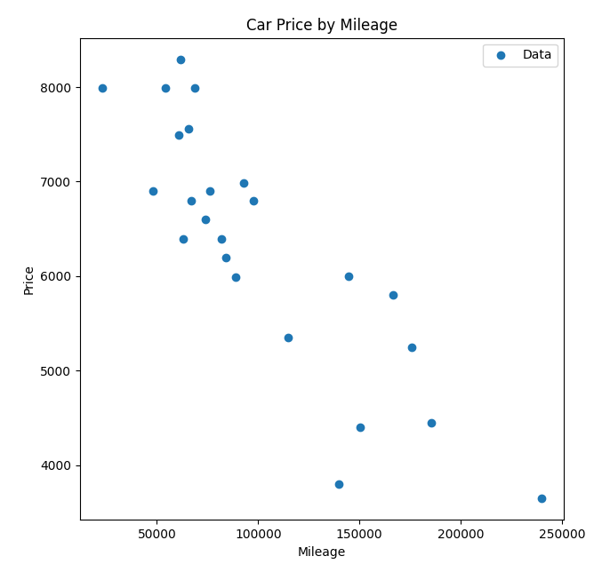
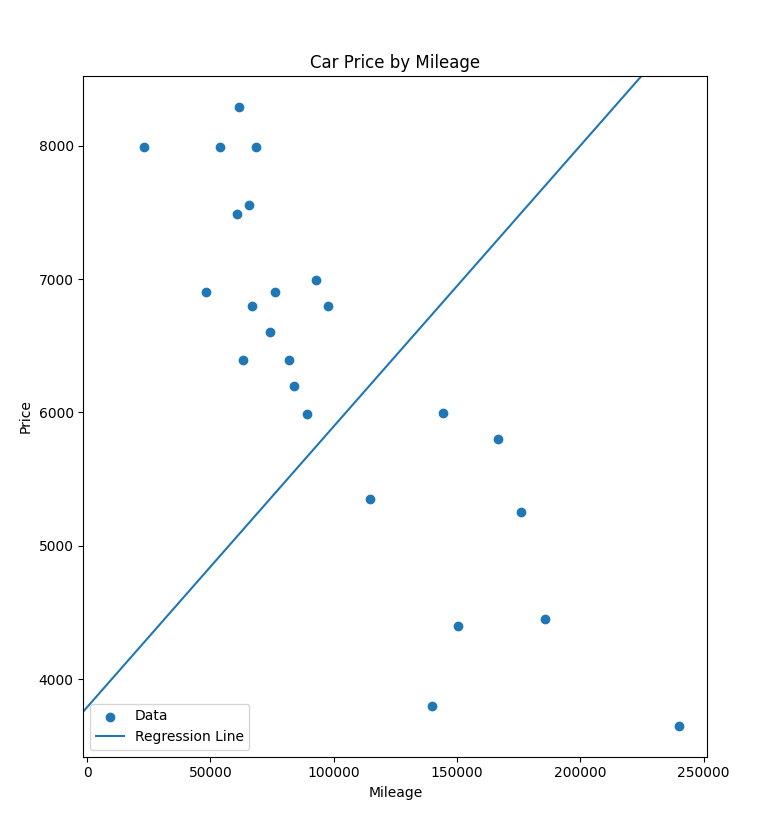
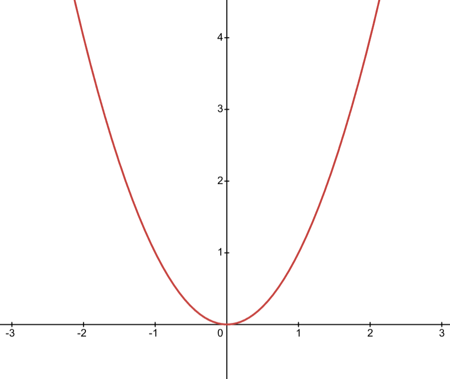
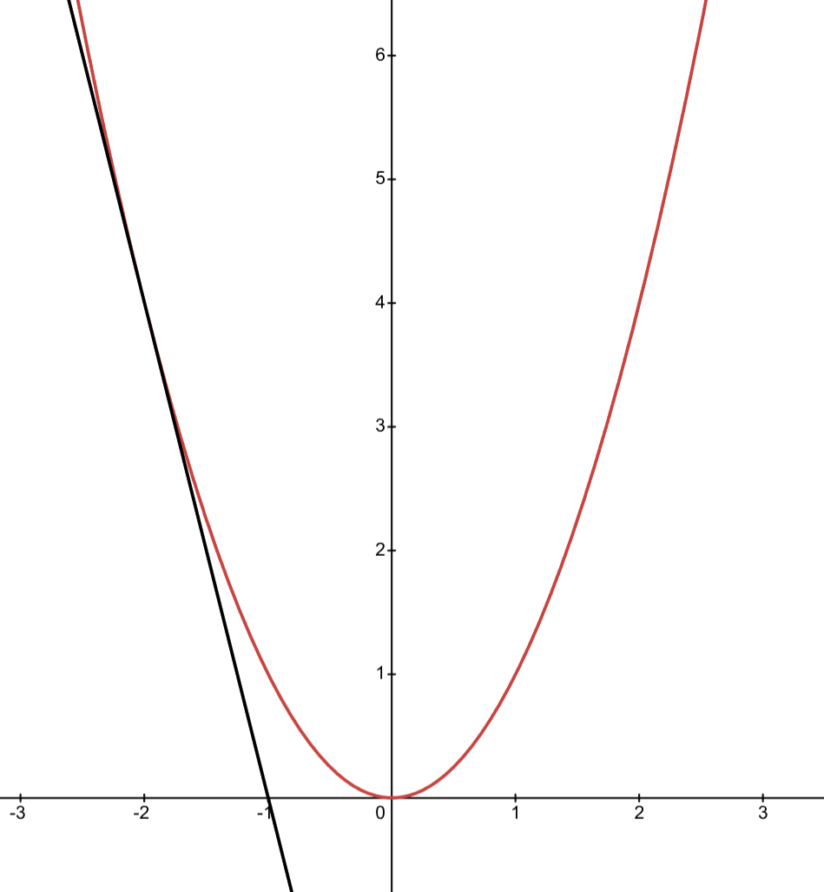
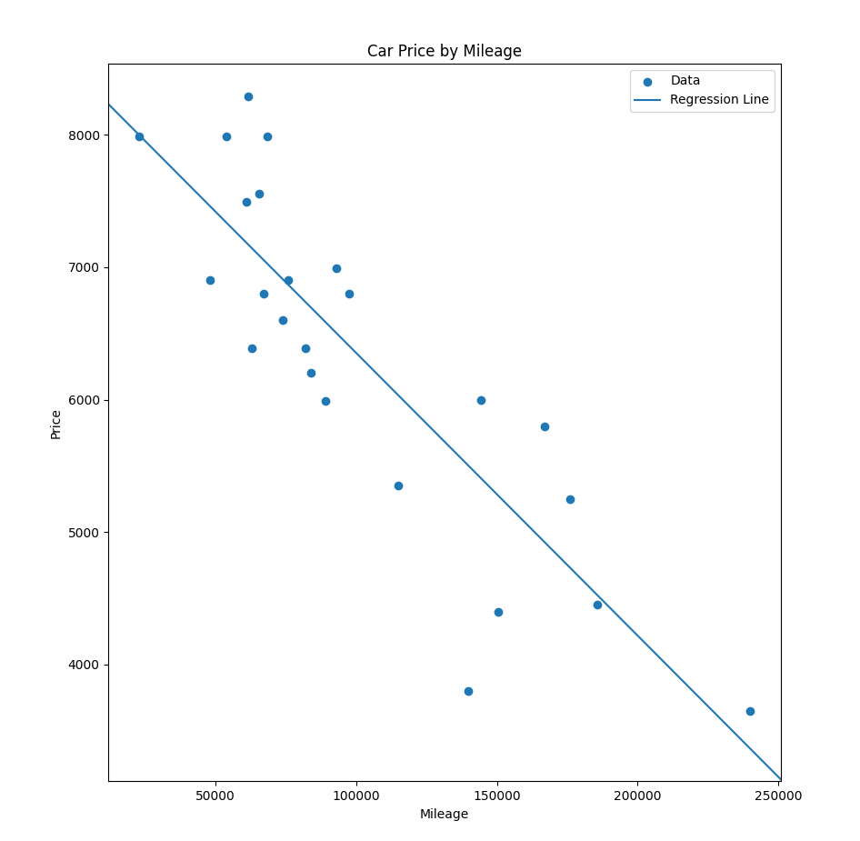
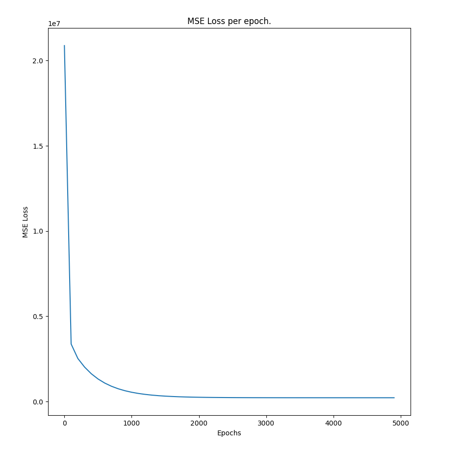
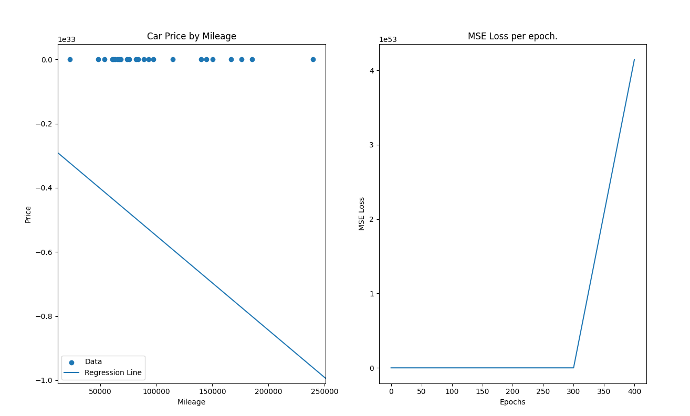

# FT Linear Regression

A one variable linear regression model that predicts the price of a car based on its mileage.

Linear regression is a machine learning algorithm that models linear relationships in data using the classic back propagation algorithm.

We can see that the data is quite linear. Although it's not on a perfect line, it's all going in the same direction.

Such function can be modeled with a line that gives us a rough estimate of the real values.

To do that, we start off with a random line:

$$ \hat{y} = wx + b $$

This line is far away from a good estimate. So we have to measure the error from the real values and this line.

For that, we use MSE, or the mean squared error. It basically averages the squared distance of each data point from the line.

**MSE**
$$\frac{1}{m} \sum_{i=1}^m (y_i - \hat{y_i})^2$$

This will give us an overall error for our model. Our goal it iteratively update our model's `parameters`, `w` and `b` so we can get a better estimate and minimize this error.

We do this by implementing the gradient descent algorithm.

It basically calculates the rate of change of the MSE as our parameters change a tiny bit. In other words, we use the derivative to update the parameters.

This example shows us the derivative at point -2. We can see that the given line is directing us towards the bottom of the loss function, which is what we're aiming for.

However, we can't just use the derivatives to update the parameters because then we'll have big jumps in the loss rather than approaching the optima.

To fix that, we use a parameter called the `learning rate`. It's a small value that reduces our update size.

**Derivates**\
$\frac{d}{dw_i} = (y_i - \hat{y_i}) \cdot x_i$\
$\frac{d}{db_i} = (y_i - \hat{y_i})$

**Updates**\
$w_t = w_{t-1} - lr \cdot \sum_{i=1}^m (y_i - \hat{y_i}) \cdot x_i$\
$b_t = b_{t-1} - lr \cdot \sum_{i=1}^m (y_i - \hat{y_i})$

we run these updates for a number of iterations until we're satisfied with the results.

we'll end up with a line like this:

It doesn't fit the data perfectly, but it gives us the best estimate for this data.

Here's how our error changes through training iterations:

We can see that the error stops changing as we get to the optima. That's because the derivative at the optima becomes very low that our training pretty much doesn't make any updates at all. That being said, even if we don't know what error value we're aiming for, we just need to set the number of iterations larg enough for our model to converge. It's also important to set the right `learning rate` so that the learning progresses steadily.

For the latter, we used $lr = 0.01$, to better observe the effects of the learning rate on training. Let's change it to $0.9$

We can see that it gave us a huge error that only kept getting worse, and a terrible prediction. So it's very important to choose a proper value for the learning rate.
